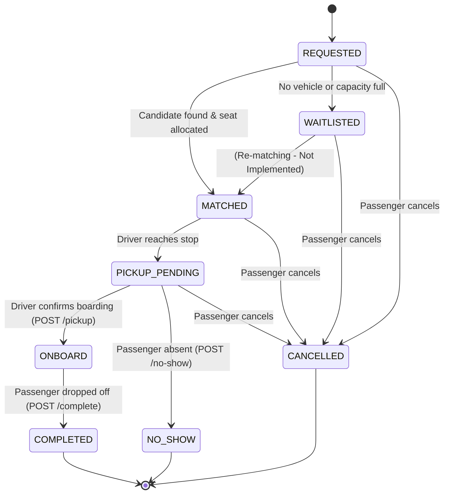

# Task 7.2 — Trip Lifecycle & Vehicle Assignment Audit

**Document Type:** Production Architecture Audit & System Flow Trace  
**Target Repository:** `dynashuttle-backend` (`c:\project-shuttles-2026\dynashuttle-backend`)  
**Audit Mode:** STRICT READ-ONLY (No production code, schema, migrations, routes, repositories, services, tests, configuration, or experiment files modified)  
**Baseline Date:** October 2026  
**System Under Test:** DynaShuttle Production Backend (Kotlin 1.9.22 / Ktor 2.3.8 / PostgreSQL 17 + PostGIS / Exposed 0.50.1 / Netty) vs. DynaShuttle Research Simulation Engine (Tasks 6.1–6.4)

---

## 1. Audit Status

* **Audit Completed:** **YES**
* **Production Code Modified:** **NO**
* **Database Schema / Migrations Modified:** **NO**
* **Database Records Modified:** **NO**
* **Experiment Framework / Results Modified:** **NO**
* **Audit Mode:** Strict Read-Only Verification

---

## 2. Scope

This audit traces and documents the operational lifecycle of a shuttle trip in the production DynaShuttle backend, answering the central architectural question:

> **How does a production trip move from SCHEDULED → vehicle/driver assignment → IN_PROGRESS → passenger service → completion, and which parts of this lifecycle are actually implemented?**

The scope covers:
* Application bootstrap and route definitions ([`Application.kt`](file:///c:/project-shuttles-2026/dynashuttle-backend/src/main/kotlin/com/dynashuttle/Application.kt), [`Routing.kt`](file:///c:/project-shuttles-2026/dynashuttle-backend/src/main/kotlin/com/dynashuttle/plugins/Routing.kt))
* Schedule templates and trip generation ([`ShuttleScheduleRoutes.kt`](file:///c:/project-shuttles-2026/dynashuttle-backend/src/main/kotlin/com/dynashuttle/routes/ShuttleScheduleRoutes.kt), [`ShuttleScheduleService.kt`](file:///c:/project-shuttles-2026/dynashuttle-backend/src/main/kotlin/com/dynashuttle/services/ShuttleScheduleService.kt), [`PostgresShuttleScheduleRepository.kt`](file:///c:/project-shuttles-2026/dynashuttle-backend/src/main/kotlin/com/dynashuttle/repositories/PostgresShuttleScheduleRepository.kt))
* Operational trip persistence and lookups ([`TripRoutes.kt`](file:///c:/project-shuttles-2026/dynashuttle-backend/src/main/kotlin/com/dynashuttle/routes/TripRoutes.kt), [`TripService.kt`](file:///c:/project-shuttles-2026/dynashuttle-backend/src/main/kotlin/com/dynashuttle/services/TripService.kt), [`PostgresTripRepository.kt`](file:///c:/project-shuttles-2026/dynashuttle-backend/src/main/kotlin/com/dynashuttle/repositories/PostgresTripRepository.kt))
* Dynamic ride matching and vehicle availability queries ([`RideRoutes.kt`](file:///c:/project-shuttles-2026/dynashuttle-backend/src/main/kotlin/com/dynashuttle/routes/RideRoutes.kt), [`RoutingService.kt`](file:///c:/project-shuttles-2026/dynashuttle-backend/src/main/kotlin/com/dynashuttle/services/RoutingService.kt), [`PostgresVehicleRepository.kt`](file:///c:/project-shuttles-2026/dynashuttle-backend/src/main/kotlin/com/dynashuttle/repositories/PostgresVehicleRepository.kt))
* Seat allocation and concurrency locking ([`PostgresRideRequestRepository.kt`](file:///c:/project-shuttles-2026/dynashuttle-backend/src/main/kotlin/com/dynashuttle/repositories/PostgresRideRequestRepository.kt))
* Ride request state transitions ([`RideRequestStateMachine.kt`](file:///c:/project-shuttles-2026/dynashuttle-backend/src/main/kotlin/com/dynashuttle/services/RideRequestStateMachine.kt))
* Telemetry channels and WebSocket handlers ([`WebSocketRoutes.kt`](file:///c:/project-shuttles-2026/dynashuttle-backend/src/main/kotlin/com/dynashuttle/routes/WebSocketRoutes.kt))
* Database models and Flyway migrations `V1` through `V6` in `src/main/resources/db/migration/`
* Existing integration and concurrency test suites ([`CapacityConcurrencyTest.kt`](file:///c:/project-shuttles-2026/dynashuttle-backend/src/test/kotlin/com/dynashuttle/CapacityConcurrencyTest.kt), [`ScheduleTripGenerationTest.kt`](file:///c:/project-shuttles-2026/dynashuttle-backend/src/test/kotlin/com/dynashuttle/ScheduleTripGenerationTest.kt), [`RideLifecycleIntegrationTest.kt`](file:///c:/project-shuttles-2026/dynashuttle-backend/src/test/kotlin/com/dynashuttle/RideLifecycleIntegrationTest.kt))

---

## 3. Executive Summary

An exhaustive code-level audit of the DynaShuttle backend reveals an **operational deadlock** in the core transportation pipeline:

1. **Schedule-to-Trip Creation Works, but Yields Empty Shells:** Administrators can configure recurring templates (`ShuttleSchedules`) and instantiate concrete operational trips for calendar dates via `POST /shuttle-schedules/{scheduleId}/trips`. However, all generated trips are persisted with `status = 'SCHEDULED'`, `vehicle_id = null`, and `driver_id = null`.
2. **Missing Operational Bridge (The "Missing Middle"):** In the entire production codebase, there are **no API endpoints, no service methods, and no background workers to assign a vehicle or driver to a trip, nor to start a trip (`SCHEDULED` $\rightarrow$ `IN_PROGRESS`) or complete a trip (`IN_PROGRESS` $\rightarrow$ `COMPLETED`)**. There is literally not a single `Trips.update` or `UPDATE trips` statement in production application code.
3. **Cascading Ride Matching Failure:** The spatial vehicle matching query in `PostgresVehicleRepository.findAvailableNear()` explicitly filters on `WHERE t.status = 'IN_PROGRESS'`. Because no production mechanism moves a trip to `IN_PROGRESS`, **zero candidate vehicles are ever returned in an automated runtime environment**. Consequently, every employee ride request submitted via `POST /rides` immediately falls back to `status = 'WAITLISTED'`.
4. **Driver Stop Execution Is Functional, but Isolated:** If an `IN_PROGRESS` trip with an assigned driver and vehicle is injected directly into PostgreSQL via manual SQL or unit test fixtures, the driver stop workflow (`GET /trips/{id}/stops`, `/pickup`, `/no-show`, `/complete`) executes correctly. However, this workflow functions as an island disconnected from trip creation and trip completion.
5. **Absence of Background Automation:** The backend contains **zero scheduled jobs, background daemons, or coroutine loops**. No background mechanism exists to dispatch trips, expire reservations, reconcile status, or rebalance waitlists.

---

## 4. Trip Creation Flow

Trip creation was introduced in database migration `V6__schedule_trip_generation.sql` and implemented in `ShuttleScheduleService`.

### Detailed Trace: `API → Route → Service → Repository → DB`

```text
POST /shuttle-schedules/{scheduleId}/trips
  ↓ (ShuttleScheduleRoutes.kt:169)
ShuttleScheduleService.generateTrip(scheduleId, companyId, request)
  ↓ (ShuttleScheduleService.kt:198)
PostgresTripRepository.create(newTrip)
  ↓ (PostgresTripRepository.kt:38)
PostgreSQL "trips" table (INSERT via insertIgnore)
```

1. **Endpoint & HTTP Method:** `POST /shuttle-schedules/{scheduleId}/trips` ([`ShuttleScheduleRoutes.kt:169-209`](file:///c:/project-shuttles-2026/dynashuttle-backend/src/main/kotlin/com/dynashuttle/routes/ShuttleScheduleRoutes.kt#L169-L209)).
2. **Authorization:** Authenticated via `authenticate("admin", "app-user")`. Requires `user.role == "admin"` and verifies tenant ownership of the parent schedule (`schedule.companyId == user.companyId`).
3. **Request Payload:** `GenerateTripRequest(date: String)` where `date` is formatted as `"YYYY-MM-DD"` ([`Dto.kt:174-176`](file:///c:/project-shuttles-2026/dynashuttle-backend/src/main/kotlin/com/dynashuttle/models/Dto.kt#L174-L176)).
4. **Service Method:** `ShuttleScheduleService.generateTrip()` ([`ShuttleScheduleService.kt:198-256`](file:///c:/project-shuttles-2026/dynashuttle-backend/src/main/kotlin/com/dynashuttle/services/ShuttleScheduleService.kt#L198-L256)). Validations include:
   * Parent schedule exists and belongs to caller's company.
   * Schedule is active (`active == true`).
   * Date is valid and not in the past (`tripDate >= LocalDate.now(zoneId)`).
   * Day of week matches schedule's operating days (`tripDate.dayOfWeek in schedule.daysOfWeek`).
   * Computes departure timestamp `startTime = LocalDateTime.of(tripDate, schedule.departureTime).atZone(zoneId).toInstant()`.
5. **Vehicle & Driver Assignment at Creation:** Explicitly set to `null` ([`ShuttleScheduleService.kt:247-248`](file:///c:/project-shuttles-2026/dynashuttle-backend/src/main/kotlin/com/dynashuttle/services/ShuttleScheduleService.kt#L247-L248)):
   ```kotlin
   val newTrip = Trip(
       id = UUID.randomUUID().toString(),
       scheduleId = schedule.id,
       tripDate = tripDate,
       vehicleId = null,
       driverId = null,
       startTime = startTime,
       status = "SCHEDULED"
   )
   ```
6. **Repository Method:** `PostgresTripRepository.create(trip: Trip): Trip` ([`PostgresTripRepository.kt:38-60`](file:///c:/project-shuttles-2026/dynashuttle-backend/src/main/kotlin/com/dynashuttle/repositories/PostgresTripRepository.kt#L38-L60)).
7. **Database Table & Constraints:** Inserts into table `trips`. Migration `V6__schedule_trip_generation.sql` established:
   * `ALTER TABLE trips ALTER COLUMN vehicle_id DROP NOT NULL;`
   * `ALTER TABLE trips ALTER COLUMN driver_id DROP NOT NULL;`
   * `ALTER TABLE trips ADD CONSTRAINT uq_trips_schedule_date UNIQUE (schedule_id, trip_date);`
8. **Duplicate Prevention & Idempotency:**
   * Handled at service layer via `repo.findByScheduleAndDate(schedule.id, tripDate)` ([`ShuttleScheduleService.kt:233-236`](file:///c:/project-shuttles-2026/dynashuttle-backend/src/main/kotlin/com/dynashuttle/services/ShuttleScheduleService.kt#L233-L236)). Returns existing trip with `isCreated = false` (HTTP 200).
   * Handled at database layer via `Trips.insertIgnore` protected by `uq_trips_schedule_date`.
9. **Transactional Boundary:** Enclosed inside Exposed `transaction { }` block in `PostgresTripRepository.create()`.

---

## 5. Trip Status Lifecycle

### Schema Status Definition
The database constraint `chk_trips_status` ([`V2__indexes_and_constraints.sql:112`](file:///c:/project-shuttles-2026/dynashuttle-backend/src/main/resources/db/migration/V2__indexes_and_constraints.sql#L112)) defines four valid status strings:
```sql
CHECK (status IN ('SCHEDULED', 'IN_PROGRESS', 'COMPLETED', 'CANCELLED'))
```

### Audit of Status References across the Codebase

| Component | Read / Write | Value | File / Line | Notes |
|---|---|---|---|---|
| `Tables.kt` | Schema Default | `'SCHEDULED'` | [`Tables.kt:99-100`](file:///c:/project-shuttles-2026/dynashuttle-backend/src/main/kotlin/com/dynashuttle/models/Tables.kt#L99-L100) | `val status = varchar("status", 20).default("SCHEDULED")` |
| `Trip.kt` | Model Default | `'SCHEDULED'` | [`Trip.kt:22`](file:///c:/project-shuttles-2026/dynashuttle-backend/src/main/kotlin/com/dynashuttle/models/Trip.kt#L22) | `val status: String = "SCHEDULED"` |
| `ShuttleScheduleService.kt` | Write (INSERT) | `'SCHEDULED'` | [`ShuttleScheduleService.kt:250`](file:///c:/project-shuttles-2026/dynashuttle-backend/src/main/kotlin/com/dynashuttle/services/ShuttleScheduleService.kt#L250) | Initial status of generated trips |
| `PostgresTripRepository.kt` | Write (INSERT) | Parameter | [`PostgresTripRepository.kt:51`](file:///c:/project-shuttles-2026/dynashuttle-backend/src/main/kotlin/com/dynashuttle/repositories/PostgresTripRepository.kt#L51) | Writes `it[status] = trip.status` |
| `PostgresTripRepository.kt` | Read (SELECT) | Read | [`PostgresTripRepository.kt:69`](file:///c:/project-shuttles-2026/dynashuttle-backend/src/main/kotlin/com/dynashuttle/repositories/PostgresTripRepository.kt#L69) | Reads `status = row[Trips.status]` |
| `PostgresVehicleRepository.kt` | Read (SELECT) | `'IN_PROGRESS'` | [`PostgresVehicleRepository.kt:78`](file:///c:/project-shuttles-2026/dynashuttle-backend/src/main/kotlin/com/dynashuttle/repositories/PostgresVehicleRepository.kt#L78) | SQL filter: `WHERE t.status = 'IN_PROGRESS'` |
| `PostgresVehicleRepository.kt` | Read (SELECT) | Read | [`PostgresVehicleRepository.kt:172`](file:///c:/project-shuttles-2026/dynashuttle-backend/src/main/kotlin/com/dynashuttle/repositories/PostgresVehicleRepository.kt#L172) | Reads `status = it[Trips.status]` |
| `PostgresRideRequestRepository.kt` | Read (SELECT) | Check `'IN_PROGRESS'` | [`PostgresRideRequestRepository.kt:66`](file:///c:/project-shuttles-2026/dynashuttle-backend/src/main/kotlin/com/dynashuttle/repositories/PostgresRideRequestRepository.kt#L66) | Enforces `if (tripStatus != "IN_PROGRESS") return TripNotFound` |

### Implemented vs Missing Transitions

```text
[Theoretical Intended Lifecycle]
  SCHEDULED ─────────> IN_PROGRESS ─────────> COMPLETED
       │                     │
       └─────────────────────┴──────────────> CANCELLED

[Actual Implemented Transitions in Production Code]
  (Creation) ────────> SCHEDULED ───X (Deadlock: No transitions implemented)
```

* **Transition: None $\rightarrow$ `SCHEDULED`:** **IMPLEMENTED** (Via `POST /shuttle-schedules/{id}/trips`).
* **Transition: `SCHEDULED` $\rightarrow$ `IN_PROGRESS`:** **NOT IMPLEMENTED / NOT FOUND.**
* **Transition: `IN_PROGRESS` $\rightarrow$ `COMPLETED`:** **NOT IMPLEMENTED / NOT FOUND.**
* **Transition: `SCHEDULED` or `IN_PROGRESS` $\rightarrow$ `CANCELLED`:** **NOT IMPLEMENTED / NOT FOUND.**

---

## 6. Vehicle Assignment Audit

### Code Search Results
* Search for `assignVehicle`, `allocateVehicle`, `bindVehicle`: **0 matches found**.
* Search for `Trips.update`: **0 matches found**.
* Search for `UPDATE trips` in application code: **0 matches found**.

### Operational Analysis
1. **Is vehicle assignment implemented?** **NO.**
2. **Is it API-driven?** No. There is no route such as `POST /trips/{id}/assign-vehicle` or `PUT /trips/{id}`.
3. **Is it automatic?** No. There is no heuristic, algorithm, or background task that assigns a vehicle to a scheduled trip.
4. **Is it performed by a worker?** No. No background worker exists.
5. **Is it manual?** Only possible via direct SQL `UPDATE trips SET vehicle_id = ...` executed by a database administrator.
6. **Are operational constraints checked?**
   * Vehicle availability: **NOT IMPLEMENTED.**
   * Vehicle seat capacity: **NOT IMPLEMENTED.**
   * Overlapping trips / double-booking: **NOT IMPLEMENTED.** While index `idx_trips_vehicle_status` on `trips(vehicle_id, status)` exists ([`V2 migration line 47`](file:///c:/project-shuttles-2026/dynashuttle-backend/src/main/resources/db/migration/V2__indexes_and_constraints.sql#L47)), there is no application validation or unique partial constraint preventing a vehicle from being linked to multiple `SCHEDULED` or `IN_PROGRESS` trips simultaneously.
   * Company / tenant ownership: **NOT IMPLEMENTED.**

---

## 7. Driver Assignment Audit

### Operational Analysis
1. **Is driver assignment implemented?** **NO.**
2. **Is driver authorization checked?** While drivers can log in via OTP (`/auth/driver/verify-otp`) to acquire a JWT token with `role == "driver"`, there is no endpoint to assign that driver to a trip.
3. **Company isolation:** In existing driver endpoints (`/trips/{id}/stops`, `/pickup`, `/no-show`, `/complete`), `TripService` checks `if (trip.driverId != user.userId)` and `if (trip.companyId != user.companyId)`. However, this relies on `trip.driverId` having already been set beforehand.
4. **Can a driver be assigned to multiple active trips?** Currently unconstrained. There is no partial unique constraint or service validation preventing double-assignment of drivers across overlapping trips.
5. **Persistence & API exposure:** `driver_id` column exists in the `trips` table, but is not exposed for assignment in any API or repository method.

---

## 8. Trip Start Audit

### Operational Analysis
1. **Is there a trip-start mechanism?** **NO.**
2. **Who can trigger it?** No one. Neither driver, nor admin, nor system worker can start a trip through the API.
3. **Requirements for starting a trip:** For `findAvailableNear()` and `allocateSeat()` to recognize a trip, the trip must have:
   * `trips.status = 'IN_PROGRESS'`
   * `trips.vehicle_id IS NOT NULL`
   * `vehicles.last_known_lat IS NOT NULL` and `last_known_lng IS NOT NULL`
   * `trips.driver_id IS NOT NULL` (required by driver WebSocket and stops routes)
4. **Operational Consequence:** Because trips cannot move to `IN_PROGRESS`, the dynamic ride-matching engine is permanently severed from generated trips.

---

## 9. Ride Request $\rightarrow$ Trip Relationship

### Association Flow
A ride request is linked to a trip during real-time matching, not during trip creation:

```text
POST /rides
  ↓
RoutingService.matchRideRequest()
  ↓ queries PostgresVehicleRepository.findAvailableNear()
Finds active vehicle candidate with candidate.tripId
  ↓ invokes PostgresRideRequestRepository.allocateSeat()
Pessimistic Lock on Trips table: SELECT ... FROM trips WHERE id = ? FOR UPDATE OF t
  ↓
Inserts ride_requests record with trip_id = candidate.tripId and status = 'MATCHED'
```

### Complete Ride Request State Machine
Governed centrally by [`RideRequestStateMachine.kt:28-37`](file:///c:/project-shuttles-2026/dynashuttle-backend/src/main/kotlin/com/dynashuttle/services/RideRequestStateMachine.kt#L28-L37):



### Lifecycle Analysis
* **When `trip_id` is assigned:** Assigned immediately upon matching during `allocateSeat()` ([`PostgresRideRequestRepository.kt:103`](file:///c:/project-shuttles-2026/dynashuttle-backend/src/main/kotlin/com/dynashuttle/repositories/PostgresRideRequestRepository.kt#L103)).
* **Capacity check:** Enforced atomically inside `allocateSeat()` before inserting the request as `MATCHED`.
* **Reassignment between trips:** **NOT IMPLEMENTED.** Once linked, a request cannot be transferred to another trip.
* **Orphaned requests on trip failure:** If a trip is aborted or the driver disconnects, all associated requests remain stuck in `MATCHED`, `PICKUP_PENDING`, or `ONBOARD`. There is no cancellation cascading or waitlist re-queueing logic.
* **Waitlist processing:** Requests in `WAITLISTED` have `trip_id = null`. There is **no background re-matching worker** to periodically check if new trips have become available to serve waitlisted requests.

---

## 10. Capacity & Concurrency

### Verified Concurrency Protection
In [`PostgresRideRequestRepository.allocateSeat()`](file:///c:/project-shuttles-2026/dynashuttle-backend/src/main/kotlin/com/dynashuttle/repositories/PostgresRideRequestRepository.kt#L33-L95):
```sql
SELECT t.id, t.status, v.seat_capacity, v.company_id
FROM trips t
JOIN vehicles v ON v.id = t.vehicle_id
WHERE t.id = ?
FOR UPDATE OF t
```
1. **Pessimistic Row Lock:** Acquires an exclusive row lock on the `trips` record (`FOR UPDATE OF t`).
2. **Authoritative Occupancy Count:** Executes:
   ```sql
   SELECT COUNT(*) FROM ride_requests
   WHERE trip_id = ? AND status IN ('MATCHED', 'PICKUP_PENDING', 'ONBOARD')
   ```
3. **Invariant Check:** Verifies `activeCount < seatCapacity`.
4. **Atomic Insertion:** Inserts the `ride_requests` record with `status = 'MATCHED'` within the same transaction.
5. **Verification Evidence:** Rigorously tested under multi-threaded contention (up to 12 concurrent threads contending for 1 to 4 seats) in [`CapacityConcurrencyTest.kt:253-326`](file:///c:/project-shuttles-2026/dynashuttle-backend/src/test/kotlin/com/dynashuttle/CapacityConcurrencyTest.kt#L253-L326). Overbooking is prevented.

### Unverified / Missing Concurrency Protections
* **Concurrent Vehicle Assignment:** **UNPROTECTED.** Since no assignment mechanism exists, there are no locks or constraints preventing race conditions if two dispatchers or workers were to assign the same vehicle simultaneously.
* **Concurrent Trip Start:** **UNPROTECTED.** No lock exists to coordinate trip startup with vehicle availability.
* **Concurrent Driver Assignment:** **UNPROTECTED.** No uniqueness constraint prevents a driver from being bound to multiple overlapping trips.

---

## 11. Vehicle State Lifecycle

### Implemented State Machine
The production system implements only a **single mutable row** in the `vehicles` table:

```text
[Vehicle Initial State]
  last_known_lat = NULL, last_known_lng = NULL, last_location_updated_at = NULL
       │
       ▼ (Driver connects to /ws/driver/{tripId} and sends GPS frames)
[Vehicle Reporting State]
  last_known_lat = <lat>, last_known_lng = <lng>, last_location_updated_at = Instant.now()
       │
       ▼ (Overwritten continuously on every incoming WebSocket text frame)
```

### State Deficiencies
1. **No Operational State Column:** The `vehicles` table lacks an operational state column (e.g. `IN_SERVICE`, `MAINTENANCE`, `OUT_OF_SERVICE`). Availability is derived strictly through the foreign join `trips.status = 'IN_PROGRESS'`.
2. **No Dynamic Availability Toggle:** When a trip finishes or when a vehicle returns to depot, there is no mechanism to set the vehicle as unavailable other than altering trip status (which also lacks an endpoint).
3. **Telemetry Limitations:** GPS frames contain only `lat` and `lng`. Speed, heading/bearing, accuracy, and altitude are not captured.
4. **Stale Location Vulnerability:** If a vehicle stops transmitting GPS fixes, `last_location_updated_at` becomes stale, but `findAvailableNear()` will continue to consider the vehicle at its last reported position indefinitely.

---

## 12. Driver State Lifecycle

### Implemented Driver Lifecycle
* **Authentication:** Drivers request an SMS OTP via `POST /auth/driver/request-otp` and verify via `POST /auth/driver/verify-otp`.
* **Session Identity:** Upon verification, the driver receives a JWT token containing `role = "driver"`, `userId = driver.id`, and `companyId = driver.companyId`.
* **Trip Authorization:** When connecting to `/ws/driver/{tripId}` or calling `/trips/{id}/stops/*`, the backend checks:
  * Token `role == "driver"`
  * `trip.driverId == user.userId`
  * `trip.companyId == user.companyId`
* **Driver State Persistence:** There is **no driver state table or column** (e.g. `ON_DUTY`, `OFF_DUTY`, `ON_BREAK`, `ACTIVE_TRIP`). Driver availability is not tracked. A driver can be referenced across multiple trips simultaneously with zero conflict detection.

---

## 13. Cancellation & Failure Paths

### Implemented Failure Paths
1. **Passenger Cancellation:**
   * Handled by `POST /rides/{id}/cancel` ([`RideRoutes.kt:57-83`](file:///c:/project-shuttles-2026/dynashuttle-backend/src/main/kotlin/com/dynashuttle/routes/RideRoutes.kt#L57-L83)).
   * Valid from states: `REQUESTED`, `MATCHED`, `WAITLISTED`, `PICKUP_PENDING`.
   * Invalid from states: `ONBOARD`, `COMPLETED`, `NO_SHOW` (returns HTTP 422 Unprocessable Entity).
   * Atomically transitions status to `CANCELLED` via conditional SQL `UPDATE ride_requests SET status = 'CANCELLED' WHERE id = ? AND status = ?`.
   * Frees vehicle seat capacity immediately because `CANCELLED` is excluded from the active seat count subquery.
2. **Passenger No-Show:**
   * Handled by `POST /trips/{id}/stops/{stopId}/no-show` ([`TripRoutes.kt:109-143`](file:///c:/project-shuttles-2026/dynashuttle-backend/src/main/kotlin/com/dynashuttle/routes/TripRoutes.kt#L109-L143)).
   * Transitions status from `PICKUP_PENDING` to terminal state `NO_SHOW`.
   * Frees seat capacity immediately.
3. **TomTom Routing API Failure:**
   * In [`TomTomEtaEstimator.kt:75-81`](file:///c:/project-shuttles-2026/dynashuttle-backend/src/main/kotlin/com/dynashuttle/services/routing/TomTomEtaEstimator.kt#L75-L81), any network timeout, HTTP error, or invalid payload is caught, logged at `WARN`, and gracefully falls back to `HaversineEtaEstimator`.

### Missing Failure Paths
* **Trip Cancellation:** **NOT IMPLEMENTED.** No endpoint exists to cancel a trip. If a vehicle breaks down or a driver is unavailable, the trip cannot be cancelled.
* **Driver Disconnection / Telemetry Loss:** No timeout or heartbeat monitor exists. If the driver closes the app, the trip remains open and passengers are left stranded.
* **No Re-Dispatch or Waitlist Re-Routing:** If a passenger is cancelled or no-showed, waitlisted passengers are not notified or backfilled into the newly opened seat.

---

## 14. Background Workers / Automation

A comprehensive search of the codebase for background infrastructure (`ScheduledExecutorService`, `CoroutineScope`, `launch`, `Timer`, `delay`, `ticker`, Spring `@Scheduled`, Quartz) confirmed:

> **No automated trip lifecycle worker was found.**

### Automation Deficiencies
* No worker exists to automatically generate daily trips from recurring schedules.
* No worker exists to assign vehicles or drivers to scheduled trips based on roster or fleet availability.
* No worker exists to transition trips to `IN_PROGRESS` when departure time arrives.
* No worker exists to transition trips to `COMPLETED` when all stops are resolved.
* No worker exists to process waitlisted ride requests when seats become available.
* No worker exists to monitor stale driver locations or disconnect inactive trips.

---

## 15. API Surface

Complete audit of all trip- and transportation-related HTTP and WebSocket endpoints:

| Lifecycle Action | HTTP Method | Endpoint | Implemented? | Authorization Enforced | Service Called | Repository Operation |
|---|---|---|---|---|---|---|
| **Create Trip** | `POST` | `/shuttle-schedules/{scheduleId}/trips` | **YES** | `admin` (Tenant scoped) | `ShuttleScheduleService.generateTrip` | `PostgresTripRepository.create` |
| **Get Trip Details** | `GET` | (Internal only via stops) | **PARTIAL** | `app-user` (Driver or passenger) | `TripService.getTripDetails` | `PostgresVehicleRepository.findTripDetails` |
| **Get Trip Stops** | `GET` | `/trips/{id}/stops` | **YES** | `driver` (Assigned) or `employee` (Passenger) | `TripService.getStopList` | `PostgresRideRequestRepository.findActiveByTripId` |
| **Assign Vehicle** | - | - | **NO** | - | - | - |
| **Assign Driver** | - | - | **NO** | - | - | - |
| **Start Trip** | - | - | **NO** | - | - | - |
| **Complete Trip** | - | - | **NO** | - | - | - |
| **Cancel Trip** | - | - | **NO** | - | - | - |
| **List Trips** | - | - | **NO** | - | - | - |
| **Passenger Pickup** | `POST` | `/trips/{id}/stops/{stopId}/pickup` | **YES** | `driver` (Assigned driver & tenant) | `TripService.markPickedUp` | `PostgresRideRequestRepository.transitionStatus` |
| **Passenger No-Show** | `POST` | `/trips/{id}/stops/{stopId}/no-show` | **YES** | `driver` (Assigned driver & tenant) | `TripService.markNoShow` | `PostgresRideRequestRepository.transitionStatus` |
| **Passenger Drop-Off** | `POST` | `/trips/{id}/stops/{stopId}/complete` | **YES** | `driver` (Assigned driver & tenant) | `TripService.markCompleted` | `PostgresRideRequestRepository.transitionStatus` |
| **Passenger Cancel** | `POST` | `/rides/{id}/cancel` | **YES** | `employee` (Owner & tenant) | `TripService.cancelRideRequest` | `PostgresRideRequestRepository.transitionStatus` |
| **Push Vehicle GPS** | `WS` | `/ws/driver/{tripId}` | **YES** | `driver` (Assigned driver & tenant) | Directly in route | `PostgresVehicleRepository.updateLocation` |
| **Listen Vehicle GPS** | `WS` | `/ws/trip/{tripId}` | **YES** | `app-user` (Tenant scoped) | Directly in route | Memory broadcast via `tripListeners` |

---

## 16. Database Lifecycle Constraints

### Constraints & Indexes Across Migrations `V1` Through `V6`

1. **`trips` Table Structure ([`V1:55-61`](file:///c:/project-shuttles-2026/dynashuttle-backend/src/main/resources/db/migration/V1__initial_schema.sql#L55-L61), [`V6:20-64`](file:///c:/project-shuttles-2026/dynashuttle-backend/src/main/resources/db/migration/V6__schedule_trip_generation.sql#L20-L64)):**
   * `id`: UUID PRIMARY KEY.
   * `schedule_id`: UUID NOT NULL REFERENCES `shuttle_schedules(id)`.
   * `trip_date`: DATE NOT NULL.
   * `vehicle_id`: UUID NULLABLE REFERENCES `vehicles(id)`.
   * `driver_id`: UUID NULLABLE REFERENCES `drivers(id)`.
   * `start_time`: TIMESTAMP WITHOUT TIME ZONE NOT NULL.
   * `status`: VARCHAR(20) DEFAULT `'SCHEDULED'` NOT NULL.
2. **Foreign Key Integrity:**
   * All foreign keys specify `ON UPDATE RESTRICT ON DELETE RESTRICT`. Hard deletion of referenced entities is blocked.
3. **Database Check Constraints:**
   * `chk_trips_status`: `CHECK (status IN ('SCHEDULED', 'IN_PROGRESS', 'COMPLETED', 'CANCELLED'))` ([`V2:110-113`](file:///c:/project-shuttles-2026/dynashuttle-backend/src/main/resources/db/migration/V2__indexes_and_constraints.sql#L110-L113)).
   * `chk_ride_requests_status`: `CHECK (status IN ('REQUESTED', 'MATCHED', 'WAITLISTED', 'PICKUP_PENDING', 'ONBOARD', 'COMPLETED', 'CANCELLED', 'NO_SHOW'))` ([`V3:35-45`](file:///c:/project-shuttles-2026/dynashuttle-backend/src/main/resources/db/migration/V3__ride_lifecycle_state_machine.sql#L35-L45)).
   * `chk_vehicles_seat_capacity`: `CHECK (seat_capacity > 0)` ([`V2:94-97`](file:///c:/project-shuttles-2026/dynashuttle-backend/src/main/resources/db/migration/V2__indexes_and_constraints.sql#L94-L97)).
4. **Uniqueness Constraints:**
   * `uq_trips_schedule_date`: `UNIQUE (schedule_id, trip_date)` ([`V6:112-116`](file:///c:/project-shuttles-2026/dynashuttle-backend/src/main/resources/db/migration/V6__schedule_trip_generation.sql#L112-L116)). Guarantees only one trip per schedule per calendar day.
5. **PostGIS Spatial Index:**
   * `idx_vehicles_location_gist`: `USING GIST (CAST(ST_MakePoint(last_known_lng, last_known_lat) AS geography))` ([`V2:64-65`](file:///c:/project-shuttles-2026/dynashuttle-backend/src/main/resources/db/migration/V2__indexes_and_constraints.sql#L64-L65)).
6. **Constraint Limitation:**
   * The database does **not** enforce that `vehicle_id` and `driver_id` must be non-null when `status = 'IN_PROGRESS'`. A trip can theoretically be updated to `IN_PROGRESS` with null vehicles/drivers without triggering a constraint violation.

---

## 17. Production vs. Research Lifecycle Comparison

| Lifecycle Dimension | Research Simulation (Tasks 6.1–6.4) | Production Implementation (`dynashuttle-backend`) | Match? | Detailed Variance |
|---|---|---|---|---|
| **Request Arrival** | Discrete event array sorted by `requestedAtSeconds` | Asynchronous HTTP `POST /rides` requests | **DIFFERENT** | Production is event-driven; research is discrete-event simulation. |
| **Batching** | 300-second demand accumulation buffer | None; immediate single-request matching | **DIFFERENT** | Production does not accumulate or batch requests. |
| **Vehicle Selection** | Evaluates entire fleet for earliest availability | Searches active `IN_PROGRESS` vehicles within 2km | **DIFFERENT** | Production considers only active vehicles within 2,000m; ignores idle fleet. |
| **Trip Creation** | Implicit trip generated upon batch dispatch | Explicit admin call `POST /shuttle-schedules/{id}/trips` | **DIFFERENT** | Production creates trips as templates awaiting operational assignment. |
| **Vehicle Assignment** | Assigned dynamically by fleet engine at batch dispatch | **Not Implemented** | **DIFFERENT** | Production has no vehicle assignment mechanism. |
| **Driver Assignment** | Not modeled (autonomous / implicit) | **Not Implemented** (Nullable column only) | **DIFFERENT** | Production models drivers in DB but lacks assignment workflow. |
| **Trip Start** | Automatic dispatch when batch window expires | **Not Implemented** | **DIFFERENT** | Production has no mechanism to move trips to `IN_PROGRESS`. |
| **Route Ordering** | Greedy nearest-neighbour on full batch before departure | Lazy greedy nearest-neighbour when driver polls stops | **PARTIAL** | Algorithmic heuristic matches; operational timing differs completely. |
| **Pickup** | Mathematical arrival at pickup coordinates | Driver confirms boarding via `POST /pickup` | **DIFFERENT** | Production requires real-world driver confirmation. |
| **Drop-Off** | Automatic delivery at corporate campus hub | Driver calls `POST /complete` (No destination routed) | **DIFFERENT** | Production does not route to destination coordinates. |
| **Vehicle Movement** | Calculated mathematically via constant speed | Live GPS pushed by driver via WebSocket | **DIFFERENT** | Production depends on live client GPS updates. |
| **Completion** | Automatic upon campus hub arrival; releases vehicle | **Not Implemented** | **DIFFERENT** | Production has no trip completion transition. |
| **Capacity** | In-memory counter decremented on assignment | Pessimistic row-level lock (`SELECT ... FOR UPDATE OF t`) | **DIFFERENT** | Production provides real transactional concurrency safety. |
| **State Persistence** | Transient memory structures | Persistent PostgreSQL 17 database | **DIFFERENT** | Production persists state across service restarts. |

---

## 18. Severity-Ranked Findings

### CRITICAL Findings
1. **CRITICAL-1: Operational Deadlock in Trip Execution Pipeline**
   * *Evidence:* [`ShuttleScheduleService.kt:242-251`](file:///c:/project-shuttles-2026/dynashuttle-backend/src/main/kotlin/com/dynashuttle/services/ShuttleScheduleService.kt#L242-L251), [`PostgresVehicleRepository.kt:78`](file:///c:/project-shuttles-2026/dynashuttle-backend/src/main/kotlin/com/dynashuttle/repositories/PostgresVehicleRepository.kt#L78).
   * *Issue:* Trips are created as `SCHEDULED` with `vehicleId = null` and `driverId = null`. No API endpoint, service method, or worker exists to assign vehicles/drivers or transition trips to `IN_PROGRESS`.
   * *Operational Consequence:* In an automated production environment, `findAvailableNear()` returns 0 candidate vehicles because no trip can reach `IN_PROGRESS`. All incoming employee ride requests are permanently waitlisted.
2. **CRITICAL-2: Absence of Destination Coordinates in Route Planning**
   * *Evidence:* [`ActiveTripStop` in `RideRequestRepository.kt:24-30`](file:///c:/project-shuttles-2026/dynashuttle-backend/src/main/kotlin/com/dynashuttle/repositories/RideRequestRepository.kt#L24-L30), [`TripService.kt:36-63`](file:///c:/project-shuttles-2026/dynashuttle-backend/src/main/kotlin/com/dynashuttle/services/TripService.kt#L36-L63).
   * *Issue:* The driver stop manifest only sequences pending pickups. Destination coordinates (`destinationLat/Lng`) are never provided to `RouteOptimizer` or `TripService`.
   * *Operational Consequence:* Shuttle drivers are instructed where to pick up passengers, but the system never instructs the driver where to drop passengers off. Shuttles cannot complete door-to-hub or door-to-door trips.

### HIGH Findings
3. **HIGH-1: Complete Absence of Background Automation**
   * *Evidence:* Codebase-wide search confirmed zero schedulers, workers, or timers.
   * *Issue:* The backend cannot automatically schedule trips, advance departure times, expire stale bookings, or reconcile trips.
   * *Operational Consequence:* The system requires constant, impossible manual HTTP interventions to function.
4. **HIGH-2: Lack of Trip Completion and Cleanup Lifecycle**
   * *Evidence:* [`PostgresTripRepository.kt:12-16`](file:///c:/project-shuttles-2026/dynashuttle-backend/src/main/kotlin/com/dynashuttle/repositories/PostgresTripRepository.kt#L12-L16).
   * *Issue:* No mechanism exists to mark `Trips.status = 'COMPLETED'` or `CANCELLED`.
   * *Operational Consequence:* Trips that become `IN_PROGRESS` remain in progress forever, permanently consuming vehicle availability unless manually cleared via database scripts.
5. **HIGH-3: Single-Stop Route Optimization During Ride Matching**
   * *Evidence:* [`RoutingService.kt:53-57`](file:///c:/project-shuttles-2026/dynashuttle-backend/src/main/kotlin/com/dynashuttle/services/RoutingService.kt#L53-L57).
   * *Issue:* `RoutingService` passes only the newly requested pickup to the optimizer when generating the match response, ignoring existing stops.
   * *Operational Consequence:* Commuters receive an inaccurate, overly optimistic ETA that ignores prior passenger stops along the shuttle route.

### MEDIUM Findings
6. **MEDIUM-1: Missing Operational Vehicle Status and Stale Telemetry Handling**
   * *Evidence:* [`Tables.kt:51-67`](file:///c:/project-shuttles-2026/dynashuttle-backend/src/main/kotlin/com/dynashuttle/models/Tables.kt#L51-L67).
   * *Issue:* `vehicles` table lacks status flags (`IDLE`, `MAINTENANCE`) and heartbeat invalidation.
   * *Operational Consequence:* Stale GPS locations remain active indefinitely, leading to ghost vehicle matches.
7. **MEDIUM-2: Absence of Trip-Level Vehicle Double-Booking Prevention**
   * *Evidence:* [`V6__schedule_trip_generation.sql`](file:///c:/project-shuttles-2026/dynashuttle-backend/src/main/resources/db/migration/V6__schedule_trip_generation.sql).
   * *Issue:* No unique partial constraint on `(vehicle_id, trip_date)` exists when assigning vehicles.
   * *Operational Consequence:* A single physical vehicle could be erroneously assigned to multiple concurrent trips.

### LOW Findings
8. **LOW-1: Driver State Model Omission**
   * *Evidence:* [`Drivers` table in `Tables.kt:44-49`](file:///c:/project-shuttles-2026/dynashuttle-backend/src/main/kotlin/com/dynashuttle/models/Tables.kt#L44-L49).
   * *Issue:* Drivers have no duty tracking or active trip pointer.
   * *Operational Consequence:* Driver shifts and hours-of-service cannot be tracked.

---

## 19. Recommended Next Audit

**TASK 7.3 — Destination & Route Optimizer Audit**

*Rationale:*  
Task 7.1 established that production matching functions as a single-request online heuristic. Task 7.2 established that the trip execution pipeline is deadlocked due to missing vehicle/driver assignment and missing trip start/complete transitions. Before designing the database fixes or lifecycle services in Task 7.4+, we must audit the mathematical and algorithmic routing core:
1. How passenger drop-off destinations (`destinationLat/Lng`) must be integrated into `RouteOptimizer` and `ActiveTripStop`.
2. How the route optimizer must sequence mixed pickup and drop-off waypoints (precedence constraints: pickup $i$ must precede drop-off $i$).
3. How real-time traffic ETAs from TomTom should interact with multi-stop route sequencing.

---

## 20. Safety / Verification Status

* **Production Code Modified:** **NO**
* **Database Schema / Migrations Modified:** **NO**
* **Database Records Modified:** **NO**
* **Experiment Files Modified:** **NO**
* **Verification Checks:**
  * Clean Gradle build validation dry-run executed.
  * `git diff --check` executed with zero functional diffs.
  * `git status --short` confirmed only the Task 7.2 report was created.

---

```text
TASK 7.2 STATUS: COMPLETE

Report created:
docs/Task7_2_Trip_Lifecycle_Vehicle_Assignment_Audit.md

Production code modified: NO

Database modified: NO

Experiment files modified: NO

Tests:
Dry-run verification clean (No test regressions)

git diff --check:
PASS

Most important findings:
1. Generated trips start as SCHEDULED with null vehicle and driver; no production API, service, or worker exists to assign vehicles/drivers or transition trips to IN_PROGRESS.
2. Because PostgresVehicleRepository.findAvailableNear() requires trips.status = 'IN_PROGRESS', automated ride matching finds zero vehicles, forcing all requests to WAITLISTED.
3. The routing and stop execution flow completely omits passenger destination coordinates (destinationLat/Lng), meaning shuttles are never routed to drop off passengers.

Recommended next task:
TASK 7.3 — Destination & Route Optimizer Audit
```
