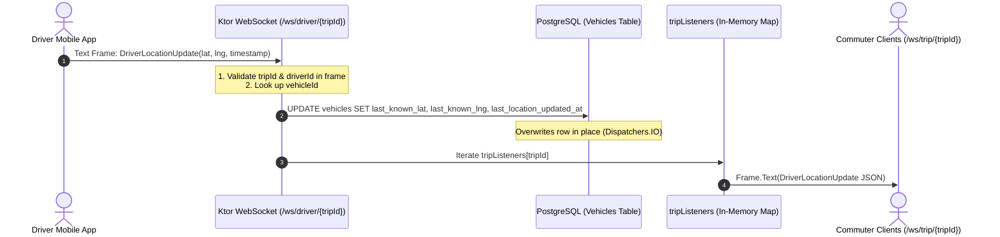

# Task 7.4 — Real-Time / WebSocket Audit

## 1. Audit Status

* **Status:** COMPLETE
* **Audit Mode:** Strictly Read-Only (no production code, models, routes, migrations, database records, tests, or experiment files modified)
* **Date:** October 7, 2026
* **Target System:** DynaShuttle Backend (`dynashuttle-backend`)
* **Previous Audits Frozen:**
  * Task 7.1: Production Architecture & Request-to-Trip Flow Audit ([Task7_1_Production_Architecture_Audit.md](file:///c:/project-shuttles-2026/dynashuttle-backend/docs/Task7_1_Production_Architecture_Audit.md))
  * Task 7.2: Trip Lifecycle & Vehicle Assignment Audit ([Task7_2_Trip_Lifecycle_Vehicle_Assignment_Audit.md](file:///c:/project-shuttles-2026/dynashuttle-backend/docs/Task7_2_Trip_Lifecycle_Vehicle_Assignment_Audit.md))
  * Task 7.3: Destination & Route Optimizer Audit ([Task7_3_Destination_Route_Optimizer_Audit.md](file:///c:/project-shuttles-2026/dynashuttle-backend/docs/Task7_3_Destination_Route_Optimizer_Audit.md))

---

## 2. Scope

This audit investigates the production real-time communication subsystem. The investigation addresses the central architectural question:

> **Can the current production WebSocket architecture support real-time vehicle telemetry, trip-state synchronization, passenger notifications, dispatch events, and dynamic route updates — or is it currently only a GPS telemetry channel?**

The audit evaluates:
1. Every registered WebSocket endpoint, session handler, and message schema.
2. Driver GPS ingestion and telemetry fan-out (`/ws/driver/{tripId}` and `/ws/trip/{tripId}`).
3. Authentication mechanisms versus fine-grained resource authorization and multi-tenant isolation.
4. Telemetry interaction with PostgreSQL spatial matching and vehicle availability.
5. Presence or absence of real-time dispatch, route update, boarding, completion, and passenger notification events.
6. Connection lifecycle management, session tracking, thread safety, and multi-instance scalability.
7. Concurrency, race conditions, error handling, and database transaction boundaries.
8. Comparative gap analysis between research simulation assumptions and real-time production mechanics.

---

## 3. Executive Summary

1. **Pure GPS Telemetry Pipe, Not a Dispatch or Coordination Channel:**
   Production WebSockets in DynaShuttle consist solely of two endpoints: `/ws/driver/{tripId}` (ingest) and `/ws/trip/{tripId}` (listener relay). The system implements **zero dispatch events, zero trip status broadcasts, zero route update broadcasts, and zero passenger lifecycle notifications**. All trip coordination, ride booking, stop status transitions, and driver stop manifests remain exclusively HTTP REST operations.

2. **Unidirectional In-Memory Repeater:**
   When a driver sends a GPS frame (`DriverLocationUpdate`), the server writes the coordinates to `Vehicles.last_known_lat/lng` in PostgreSQL and broadcasts the identical payload in memory to active WebSocket sessions in `tripListeners[tripId]`. Listener sessions are strictly read-only and receive nothing other than raw GPS coordinates.

3. **Passenger Authorization Vulnerability on `/ws/trip/{tripId}` (BOLA / IDOR):**
   While HTTP endpoints enforce passenger verification (e.g., `GET /trips/{id}/stops` checks `hasEmployeeOnTrip(tripId, user.userId)` in [TripRoutes.kt:50](file:///c:/project-shuttles-2026/dynashuttle-backend/src/main/kotlin/com/dynashuttle/routes/TripRoutes.kt#L50)), `/ws/trip/{tripId}` in [WebSocketRoutes.kt:76-93](file:///c:/project-shuttles-2026/dynashuttle-backend/src/main/kotlin/com/dynashuttle/routes/WebSocketRoutes.kt#L76-L93) verifies **only company matching** (`trip.companyId == user.companyId`). Any employee or driver within a company can track the real-time GPS coordinates of any active shuttle in that company, regardless of whether they are booked on that trip.

4. **Admin Dashboard Authentication Conflict:**
   The docstring of `WebSocketRoutes.kt` asserts that the "admin dashboard connects to `/ws/trip/{tripId}` as listeners". However, both WebSocket routes are wrapped in `authenticate("app-user")` ([WebSocketRoutes.kt:33](file:///c:/project-shuttles-2026/dynashuttle-backend/src/main/kotlin/com/dynashuttle/routes/WebSocketRoutes.kt#L33)), which explicitly restricts valid roles to `listOf("employee", "driver")` ([Authentication.kt:26](file:///c:/project-shuttles-2026/dynashuttle-backend/src/main/kotlin/com/dynashuttle/plugins/Authentication.kt#L26)). Legitimate admin JWTs generated under the `"admin"` realm fail authentication immediately.

5. **Thread Safety & Multi-Node Scalability Deficiencies:**
   Session tracking uses `ConcurrentHashMap<String, MutableList<DefaultWebSocketServerSession>>`. The map values are plain, non-synchronized `ArrayList` instances (`mutableListOf()`). Concurrent session registration, removal, and broadcast iteration are subject to `ConcurrentModificationException` and state corruption under load. Furthermore, because state is maintained solely in JVM process memory, any multi-instance horizontal scaling renders the telemetry pipeline inoperative across nodes without an external pub/sub broker.

6. **Missing Validation & DoS Vulnerability:**
   Coordinates (`lat`, `lng`) and timestamps received from the driver app are written directly to PostgreSQL without boundary checks, range constraints, or rate limiting. An unthrottled or malfunctioning client can saturate database I/O by triggering continuous synchronous write transactions.

---

## 4. WebSocket Endpoint Inventory

Inspection of [WebSocketRoutes.kt](file:///c:/project-shuttles-2026/dynashuttle-backend/src/main/kotlin/com/dynashuttle/routes/WebSocketRoutes.kt) and [Routing.kt:137](file:///c:/project-shuttles-2026/dynashuttle-backend/src/main/kotlin/com/dynashuttle/plugins/Routing.kt#L137) reveals exactly two WebSocket endpoints registered in the application:

| Endpoint | Purpose | Client | Authentication | Authorization | Data Direction | Exact Reference |
| :--- | :--- | :--- | :--- | :--- | :--- | :--- |
| `/ws/driver/{tripId}` | Ingests live driver GPS coordinates (every ~5s) and writes to DB | Driver Mobile App | JWT (`app-user` realm) | Role must be `"driver"`; caller must match `trip.driverId`; tenant must match `trip.companyId` | Bidirectional channel used unidirectionally (Client $\to$ Server text frames; Server closes on error) | [WebSocketRoutes.kt:34-74](file:///c:/project-shuttles-2026/dynashuttle-backend/src/main/kotlin/com/dynashuttle/routes/WebSocketRoutes.kt#L34-L74) |
| `/ws/trip/{tripId}` | Pushes live driver GPS updates to subscribed clients | Employee App / Admin Dashboard | JWT (`app-user` realm) | Caller must be authenticated; tenant must match `trip.companyId`. **Passenger association NOT verified** | Unidirectional Server $\to$ Client (Server pushes text frames; incoming client frames discarded) | [WebSocketRoutes.kt:76-99](file:///c:/project-shuttles-2026/dynashuttle-backend/src/main/kotlin/com/dynashuttle/routes/WebSocketRoutes.kt#L76-L99) |

No other WebSocket endpoints exist anywhere in the codebase.

---

## 5. Driver WebSocket

### 5.1 Route Handler & Lifecycle
The driver WebSocket is defined at [WebSocketRoutes.kt:34-74](file:///c:/project-shuttles-2026/dynashuttle-backend/src/main/kotlin/com/dynashuttle/routes/WebSocketRoutes.kt#L34-L74):

```kotlin
webSocket("/ws/driver/{tripId}") {
    val tripId = call.parameters["tripId"] ?: return@webSocket close()
    val user = call.authenticatedUser()
    if (user == null || user.role != "driver") {
        close(CloseReason(CloseReason.Codes.VIOLATED_POLICY, "Driver role required"))
        return@webSocket
    }

    val trip = withContext(Dispatchers.IO) {
        vehicleRepository.findTripDetails(tripId)
    }
    if (trip == null || trip.companyId != user.companyId) {
        close(CloseReason(CloseReason.Codes.VIOLATED_POLICY, "Trip not found"))
        return@webSocket
    }
    if (trip.driverId != user.userId) {
        close(CloseReason(CloseReason.Codes.VIOLATED_POLICY, "Not assigned driver for this trip"))
        return@webSocket
    }
...
```

### 5.2 Verification Details
1. **Authentication:** Authenticates via the `authenticate("app-user")` Ktor feature, extracting a `JWTPrincipal` with `userId`, `role`, and `companyId`.
2. **Trip Identification & Association:** Looks up `tripId` via `vehicleRepository.findTripDetails(tripId)`.
3. **Driver Assignment Verification:** Explicitly checks `if (trip.driverId != user.userId)`. If the driver is not assigned, the socket closes with code `VIOLATED_POLICY` (`"Not assigned driver for this trip"`).
4. **Company / Tenant Isolation:** Explicitly checks `if (trip.companyId != user.companyId)`. If mismatched, returns `"Trip not found"`.
5. **Scheduled Trip Deadlock:** In `PostgresVehicleRepository.findTripDetails()`, the query performs `(Trips innerJoin Vehicles)` ([PostgresVehicleRepository.kt:163](file:///c:/project-shuttles-2026/dynashuttle-backend/src/main/kotlin/com/dynashuttle/repositories/PostgresVehicleRepository.kt#L163)). Because scheduled trips have `vehicle_id = null` and `driver_id = null` (Task 7.2), `findTripDetails` returns `null`. Consequently, **drivers cannot connect to scheduled trips until manual DB assignment occurs**.
6. **Message Reception:** Consumes text frames decoded as `DriverLocationUpdate` ([Dto.kt:87-93](file:///c:/project-shuttles-2026/dynashuttle-backend/src/main/kotlin/com/dynashuttle/models/Dto.kt#L87-L93)):
   ```kotlin
   data class DriverLocationUpdate(
       val driverId: String,
       val tripId: String,
       val lat: Double,
       val lng: Double,
       val timestamp: Long
   )
   ```
7. **Frame Verification:** Checks `if (update.tripId != tripId || update.driverId != user.userId) return@consumeEach`.
8. **Allowed Messages:** Only accepts GPS location frames. Rejects or fails on other message schemas.
9. **No Server-to-Driver Messages:** The server never sends any frames back to the driver over this socket. Stop additions, re-routing notifications, and cancellation alerts are never sent.
10. **Rate Limiting:** **None.** Every text frame triggers a blocking database update on `Dispatchers.IO`.
11. **Malformed Messages:** `Json.decodeFromString` is unshielded by a try-catch block inside `consumeEach`. Any malformed JSON frame throws a `SerializationException`, immediately terminating the driver's WebSocket connection.
12. **Cleanup Anomaly:** The `finally` block executes `tripListeners[tripId]?.remove(this)` ([WebSocketRoutes.kt:72](file:///c:/project-shuttles-2026/dynashuttle-backend/src/main/kotlin/com/dynashuttle/routes/WebSocketRoutes.kt#L72)). However, `/ws/driver/{tripId}` **never added** `this` to `tripListeners` in the first place.

---

## 6. Trip / Passenger WebSocket

### 6.1 Route Handler & Lifecycle
The trip listener WebSocket is defined at [WebSocketRoutes.kt:76-99](file:///c:/project-shuttles-2026/dynashuttle-backend/src/main/kotlin/com/dynashuttle/routes/WebSocketRoutes.kt#L76-L99):

```kotlin
webSocket("/ws/trip/{tripId}") {
    val tripId = call.parameters["tripId"] ?: return@webSocket close()
    val user = call.authenticatedUser()
    if (user == null) {
        close(CloseReason(CloseReason.Codes.VIOLATED_POLICY, "Authentication required"))
        return@webSocket
    }

    val trip = withContext(Dispatchers.IO) {
        vehicleRepository.findTripDetails(tripId)
    }
    if (trip == null || trip.companyId != user.companyId) {
        close(CloseReason(CloseReason.Codes.VIOLATED_POLICY, "Trip not found"))
        return@webSocket
    }

    tripListeners.getOrPut(tripId) { mutableListOf() }.add(this)

    try {
        incoming.consumeEach { /* listeners are read-only, no incoming messages expected */ }
    } finally {
        tripListeners[tripId]?.remove(this)
    }
}
```

### 6.2 Verification Details
1. **Connection Eligibility:** Any user with a valid JWT belonging to the `app-user` realm (`role == "employee"` or `role == "driver"`) whose `companyId` matches `trip.companyId`.
2. **Passenger Authorization Check (BOLA / IDOR):** **Absent.** The handler verifies that `trip.companyId == user.companyId`, but **never verifies that `user.userId` has a booked ride request on this trip**. Any employee of Company A can track any vehicle operating for Company A.
3. **Data Exposed:** Subscribed clients receive real-time `DriverLocationUpdate` JSON strings whenever the assigned driver pushes GPS coordinates.
4. **Data NOT Exposed:**
   * Vehicle status / availability changes
   * Trip lifecycle state transitions (`SCHEDULED` $\to$ `IN_PROGRESS` $\to$ `COMPLETED`)
   * Dynamic ETA updates
   * Ordered stop lists or route geometry
   * Passenger boarding / drop-off confirmations
5. **Client Input:** Read-only. The server ignores any frames sent by the client (`incoming.consumeEach { /* ... */ }`).
6. **Disconnection & Cleanup:** The session is removed from `tripListeners[tripId]` in the `finally` block. However, if the list becomes empty, the key `tripId` is never pruned from the `tripListeners` `ConcurrentHashMap`, leading to memory leak over extended runtimes.

---

## 7. Authentication vs Authorization

There is a critical distinction between authentication, role-based access, and resource-level authorization in the WebSocket layer:

```text
Incoming Connection Request
   │
   ├─► 1. JWT Authentication ("app-user" realm)
   │     ├─► Valid signature & issuer? YES
   │     └─► Claim "role" in ["employee", "driver"]?
   │           ├─► "admin"  ──► REJECTED (401 Unauthorized / Handshake Refused)
   │           └─► valid    ──► Proceed to Route Handler
   │
   ├─► 2. Tenant Isolation Check
   │     └─► trip.companyId == user.companyId?
   │           ├─► Mismatch ──► REJECTED ("Trip not found")
   │           └─► Match    ──► Proceed
   │
   └─► 3. Resource Authorization Check
         ├─► For /ws/driver/{tripId}:
         │     ├─► user.role == "driver"? (YES)
         │     └─► trip.driverId == user.userId?
         │           ├─► Mismatch ──► REJECTED ("Not assigned driver for this trip")
         │           └─► Match    ──► AUTHORIZED
         │
         └─► For /ws/trip/{tripId}:
               └─► Is user a passenger on tripId?
                     └─► CHECK OMITTED ──► UNRESTRICTED WITHIN TENANT (BOLA)
```

### Summary of Access Control Rules:

| Dimension | `/ws/driver/{tripId}` | `/ws/trip/{tripId}` | HTTP `/trips/{id}/stops` |
| :--- | :--- | :--- | :--- |
| **Authentication Realm** | `app-user` | `app-user` | `app-user` |
| **Allowed Roles** | `driver` | `employee`, `driver` | `driver`, `employee` |
| **Admin Access** | Blocked by realm | Blocked by realm | Blocked by realm |
| **Tenant Isolation** | Enforced (`trip.companyId`) | Enforced (`trip.companyId`) | Enforced (`trip.companyId`) |
| **Driver Assignment Check** | Enforced (`trip.driverId == user.userId`) | N/A | Enforced for drivers |
| **Passenger Assignment Check** | N/A | **NOT ENFORCED** | Enforced (`hasEmployeeOnTrip`) |
| **Security Finding** | Normal driver authorization | **BOLA / IDOR vulnerability** | Secure |

---

## 8. GPS Telemetry Flow

The entire GPS telemetry path operates as follows:



### Verification Findings on GPS Telemetry:
1. **Coordinate Validation:** **None.** No bounding box checks, no range verification (`-90 <= lat <= 90`, `-180 <= lng <= 180`), and no check for `NaN` or `Infinity`.
2. **Timestamp Handling:** The client's `update.timestamp` is received in the DTO, but **completely ignored during persistence**. [PostgresVehicleRepository.kt:138](file:///c:/project-shuttles-2026/dynashuttle-backend/src/main/kotlin/com/dynashuttle/repositories/PostgresVehicleRepository.kt#L138) sets `lastLocationUpdatedAt = Instant.now()`. Late-arriving packets overwrite database state and receive a current server timestamp.
3. **Database Write:** Direct row update on `vehicles`. No historical audit trail or telemetry log is maintained.
4. **Triggering Side Effects:**
   * Does GPS update change vehicle availability? **NO.**
   * Does GPS update change trip status? **NO.**
   * Does GPS update trigger route recalculation? **NO.**
   * Does GPS update trigger ETA recalculation? **NO.**
   * Does GPS update trigger client broadcasts? **YES**, relays raw frame to `/ws/trip/{tripId}`.

**Classification:** **C. Persisted and broadcast only.** GPS updates are not integrated into active routing or dispatch recalculations.

---

## 9. Vehicle State Synchronization

The central question is:

> **Does the location received through the driver WebSocket actually affect the vehicle location used for subsequent ride matching?**

### The Execution Path:
1. Driver sends GPS update $\to$ written to `Vehicles.lastKnownLat` and `Vehicles.lastKnownLng` ([PostgresVehicleRepository.kt:136-137](file:///c:/project-shuttles-2026/dynashuttle-backend/src/main/kotlin/com/dynashuttle/repositories/PostgresVehicleRepository.kt#L136-L137)).
2. An employee calls `POST /rides` $\to$ invokes `RoutingService.matchRideRequest()` $\to$ invokes `PostgresVehicleRepository.findAvailableNear(pickupLat, pickupLng, companyId)` ([RoutingService.kt:33](file:///c:/project-shuttles-2026/dynashuttle-backend/src/main/kotlin/com/dynashuttle/services/RoutingService.kt#L33)).
3. `findAvailableNear()` queries PostgreSQL:
   ```sql
   SELECT v.id as vehicle_id, t.id as trip_id, t.driver_id,
          v.last_known_lat, v.last_known_lng, ...
   FROM vehicles v
   JOIN trips t ON t.vehicle_id = v.id
   WHERE t.status = 'IN_PROGRESS' AND v.status = 'ACTIVE' ...
   ORDER BY (6371 * acos(...)) ASC
   ```
4. The candidate vehicle's `last_known_lat` and `last_known_lng` are passed to `routeOptimizer.optimize(vehiclePosition, stops)` for single-stop ETA estimation ([RoutingService.kt:47-48](file:///c:/project-shuttles-2026/dynashuttle-backend/src/main/kotlin/com/dynashuttle/services/RoutingService.kt#L47-L48)).

### The Operational Disconnect:
While the database column `vehicles.last_known_lat/lng` is functionally shared between the WebSocket write and the spatial query:
* `findAvailableNear()` strictly filters on `trips.status = 'IN_PROGRESS'` ([PostgresVehicleRepository.kt:100](file:///c:/project-shuttles-2026/dynashuttle-backend/src/main/kotlin/com/dynashuttle/repositories/PostgresVehicleRepository.kt#L100)).
* Production schedule generation creates trips as `SCHEDULED` with `vehicle_id = null` and `driver_id = null` (Task 7.2).
* No production service transitions trips to `IN_PROGRESS` or assigns vehicles.
* As established in Section 5.2, drivers cannot connect to `/ws/driver/{tripId}` when `vehicle_id` is null because `(Trips innerJoin Vehicles)` yields 0 rows.
* Therefore, in normal automated operation, **the WebSocket GPS telemetry never connects with ride matching because no vehicle ever satisfies the preconditions to both stream GPS and match rides**.

---

## 10. Dispatch Events

A complete search of the entire codebase for asynchronous messaging, notifications, WebSocket broadcasts, Kotlin Flows, or channels yields the following audit results:

| Event | Backend Event Exists? | WebSocket Broadcast? | Recipient | Evidence / Implementation Behavior |
| :--- | :--- | :--- | :--- | :--- |
| **Ride Matched** | YES (HTTP Response) | **NO** | Employee (HTTP Caller only) | Synchronously returned in `POST /rides` response ([RideRoutes.kt:37](file:///c:/project-shuttles-2026/dynashuttle-backend/src/main/kotlin/com/dynashuttle/routes/RideRoutes.kt#L37)). Driver receives no event. |
| **Ride Waitlisted** | YES (HTTP Response) | **NO** | Employee (HTTP Caller only) | Synchronously returned in `POST /rides` response with status `"WAITLISTED"` ([RoutingService.kt:42](file:///c:/project-shuttles-2026/dynashuttle-backend/src/main/kotlin/com/dynashuttle/services/RoutingService.kt#L42)). |
| **Vehicle Assigned** | **NO** | **NO** | None | No automated assignment service exists in production (Task 7.2). |
| **Driver Assigned** | **NO** | **NO** | None | No automated assignment service exists in production (Task 7.2). |
| **Trip Started** | **NO** | **NO** | None | No start trip endpoint or transition to `IN_PROGRESS` exists in production. |
| **Trip Completed** | **NO** | **NO** | None | No trip-level completion mechanism exists; only individual stop completions. |
| **Passenger Picked Up** | YES (HTTP Response) | **NO** | Driver (HTTP Caller only) | `POST /trips/{id}/stops/{stopId}/pickup` returns `StopActionResponse(status="ONBOARD")` ([TripRoutes.kt:95](file:///c:/project-shuttles-2026/dynashuttle-backend/src/main/kotlin/com/dynashuttle/routes/TripRoutes.kt#L95)). Passenger receives no alert. |
| **Passenger Onboard** | YES (HTTP Response) | **NO** | Driver (HTTP Caller only) | Same as pickup. Persisted to DB; passenger is not notified over WS. |
| **Passenger Dropped Off** | YES (HTTP Response) | **NO** | Driver (HTTP Caller only) | `POST /trips/{id}/stops/{stopId}/complete` returns `StopActionResponse(status="COMPLETED")` ([TripRoutes.kt:148](file:///c:/project-shuttles-2026/dynashuttle-backend/src/main/kotlin/com/dynashuttle/routes/TripRoutes.kt#L148)). Passenger is not notified. |
| **Passenger No-Show** | YES (HTTP Response) | **NO** | Driver (HTTP Caller only) | `POST /trips/{id}/stops/{stopId}/no-show` returns `StopActionResponse(status="NO_SHOW")` ([TripRoutes.kt:122](file:///c:/project-shuttles-2026/dynashuttle-backend/src/main/kotlin/com/dynashuttle/routes/TripRoutes.kt#L122)). |
| **Route Changed** | **NO** | **NO** | None | Routes are never persisted or recalculated dynamically (Task 7.3). |
| **Stop Added** | **NO** | **NO** | None | Added to `ride_requests` table in DB, but driver is never notified via WS. |
| **Stop Removed** | **NO** | **NO** | None | Marked `CANCELLED` in DB, but driver is never notified via WS. |
| **ETA Changed** | **NO** | **NO** | None | ETA is calculated once at booking; never recalculated dynamically or pushed. |
| **Vehicle Changed** | **NO** | **NO** | None | No vehicle reassignment mechanism exists. |
| **Trip Cancelled** | YES (HTTP Response) | **NO** | Admin (HTTP Caller only) | `POST /trips/{id}/cancel` returns 200 HTTP ([TripRoutes.kt:179](file:///c:/project-shuttles-2026/dynashuttle-backend/src/main/kotlin/com/dynashuttle/routes/TripRoutes.kt#L179)). Driver and riders are not notified over WS. |

---

## 11. Route Updates

### 11.1 Dynamic Push Verification
Can a route change currently be pushed to the driver in real time?

**Trace:**
`new ride request` $\to$ `POST /rides` $\to$ `RoutingService.matchRideRequest()` $\to$ `PostgresRideRequestRepository.allocateSeat()` $\to$ Ride request inserted with `status = 'MATCHED'` and `trip_id = candidate.tripId`.

* Does this trigger a notification to the driver? **NO.**
* Does this recalculate the driver's full route? **NO.**
* Is any frame pushed over `/ws/driver/{tripId}`? **NO.**
* Is any frame pushed over `/ws/trip/{tripId}`? **NO.**

### 11.2 Operational Consequence for Drivers
The driver app has no mechanism to receive new stops while in transit. If a new passenger books a seat while a trip is active, the driver will only discover the new pickup stop if the driver manually executes an HTTP request to `GET /trips/{id}/stops`. The backend provides zero push capabilities for route updates.

---

## 12. Passenger Notifications

Audit of all passenger notification mechanisms across the backend:

1. **HTTP Responses:** The sole mechanism by which an employee receives initial ride details (vehicle, trip, initial ETA) is the synchronous JSON payload returned by `POST /rides` ([RideRoutes.kt:37](file:///c:/project-shuttles-2026/dynashuttle-backend/src/main/kotlin/com/dynashuttle/routes/RideRoutes.kt#L37)).
2. **Polling Endpoints:** The employee app must repeatedly poll `GET /rides/{id}` ([RideRoutes.kt:41-54](file:///c:/project-shuttles-2026/dynashuttle-backend/src/main/kotlin/com/dynashuttle/routes/RideRoutes.kt#L41-L54)) to discover if their status has progressed from `MATCHED` to `PICKUP_PENDING`, `ONBOARD`, or `COMPLETED`.
3. **WebSockets:** If connected to `/ws/trip/{tripId}`, the employee receives vehicle coordinates, but **never receives status changes, arrival notices, or ETA updates**.
4. **Push Notifications (FCM / APNs):** **Absent.** No push notification service or library is installed or referenced.
5. **SMS / Email:** The only email integration is `BrevoOtpSender` ([BrevoOtpSender.kt](file:///c:/project-shuttles-2026/dynashuttle-backend/src/main/kotlin/com/dynashuttle/services/BrevoOtpSender.kt)), which is exclusively wired into `AuthService` for 6-digit login OTP delivery. No ride status or trip notification emails are implemented.

---

## 13. Connection Lifecycle

### 13.1 Session Storage & Concurrency
Session tracking is implemented globally at [WebSocketRoutes.kt:29](file:///c:/project-shuttles-2026/dynashuttle-backend/src/main/kotlin/com/dynashuttle/routes/WebSocketRoutes.kt#L29):

```kotlin
private val tripListeners = ConcurrentHashMap<String, MutableList<DefaultWebSocketServerSession>>()
```

1. **Non-Thread-Safe Collection:** While `ConcurrentHashMap` guarantees thread-safe key access, its values are standard `java.util.ArrayList` instances created via `mutableListOf()`. Operations on this list:
   * Registration: `tripListeners.getOrPut(tripId) { mutableListOf() }.add(this)` ([line 92](file:///c:/project-shuttles-2026/dynashuttle-backend/src/main/kotlin/com/dynashuttle/routes/WebSocketRoutes.kt#L92))
   * Deregistration: `tripListeners[tripId]?.remove(this)` ([line 97](file:///c:/project-shuttles-2026/dynashuttle-backend/src/main/kotlin/com/dynashuttle/routes/WebSocketRoutes.kt#L97))
   * Broadcast iteration: `tripListeners[tripId]?.forEach { session -> session.send(...) }` ([line 105](file:///c:/project-shuttles-2026/dynashuttle-backend/src/main/kotlin/com/dynashuttle/routes/WebSocketRoutes.kt#L105))
   are **completely unsynchronized**. Concurrent connections, disconnections, and location frames will trigger `ConcurrentModificationException` or corrupt list pointers under concurrent load.
2. **Duplicate Connections:** The system does not detect or restrict multiple simultaneous driver sessions on the same `tripId`. Two driver devices transmitting differing GPS locations will interleave updates unpredictably.
3. **Memory Leaks:** When all listener sessions disconnect, `tripListeners[tripId]?.remove(this)` removes the session from the list, but leaves an empty `MutableList` keyed by `tripId` in the map permanently.
4. **Multi-Node Cluster Failure:** Session tracking is strictly in-process JVM memory. If the backend is deployed as multiple instances behind a load balancer, a driver connected to Node 1 will broadcast only to listeners connected to Node 1. Listeners connected to Node 2 will receive zero telemetry.

---

## 14. Error Handling

Inspection of error scenarios in WebSocket handling:

| Scenario | Server Action | Client Experience | Code Location |
| :--- | :--- | :--- | :--- |
| **Invalid / Expired JWT** | Handshake rejected | HTTP 401 Unauthorized / Upgrade Failed | Handled by Ktor `authenticate("app-user")` |
| **Role == "admin"** | Handshake rejected | HTTP 401 Unauthorized | [Authentication.kt:26](file:///c:/project-shuttles-2026/dynashuttle-backend/src/main/kotlin/com/dynashuttle/plugins/Authentication.kt#L26) |
| **Employee on Driver WS** | Closes WebSocket | CloseReason: `VIOLATED_POLICY` ("Driver role required") | [WebSocketRoutes.kt:38](file:///c:/project-shuttles-2026/dynashuttle-backend/src/main/kotlin/com/dynashuttle/routes/WebSocketRoutes.kt#L38) |
| **Unassigned Driver on Driver WS** | Closes WebSocket | CloseReason: `VIOLATED_POLICY` ("Not assigned driver for this trip") | [WebSocketRoutes.kt:50](file:///c:/project-shuttles-2026/dynashuttle-backend/src/main/kotlin/com/dynashuttle/routes/WebSocketRoutes.kt#L50) |
| **Cross-Company Trip WS** | Closes WebSocket | CloseReason: `VIOLATED_POLICY` ("Trip not found") | [WebSocketRoutes.kt:46, 88](file:///c:/project-shuttles-2026/dynashuttle-backend/src/main/kotlin/com/dynashuttle/routes/WebSocketRoutes.kt#L46) |
| **Malformed JSON from Driver** | Unhandled `SerializationException` | Connection terminates abnormally; socket closed | [WebSocketRoutes.kt:57](file:///c:/project-shuttles-2026/dynashuttle-backend/src/main/kotlin/com/dynashuttle/routes/WebSocketRoutes.kt#L57) |
| **Invalid Lat/Lng Values** | No check; written to DB | Frame processed normally; corrupted DB state | [WebSocketRoutes.kt:65](file:///c:/project-shuttles-2026/dynashuttle-backend/src/main/kotlin/com/dynashuttle/routes/WebSocketRoutes.kt#L65) |
| **PostgreSQL Write Failure** | Uncaught exception on `Dispatchers.IO` | WebSocket connection aborted immediately | [WebSocketRoutes.kt:64-66](file:///c:/project-shuttles-2026/dynashuttle-backend/src/main/kotlin/com/dynashuttle/routes/WebSocketRoutes.kt#L64-L66) |
| **Closed Listener Session during Broadcast** | Exception thrown during `session.send(...)` | Subsequent listeners in iteration may not receive update | [WebSocketRoutes.kt:105-107](file:///c:/project-shuttles-2026/dynashuttle-backend/src/main/kotlin/com/dynashuttle/routes/WebSocketRoutes.kt#L105-L107) |

---

## 15. Real-Time Consistency

Analysis of system state consistency across persistence, memory, and networking:

| State Dimension | Canonical Source of Truth | Updated By | Persisted to DB? | Broadcast over WS? | Consistency Risk |
| :--- | :--- | :--- | :--- | :--- | :--- |
| **Trip Status** | PostgreSQL `trips.status` | Admin / DB direct | YES | **NO** | High. Clients have no way to know trip started/ended except polling. |
| **Vehicle Position** | PostgreSQL `vehicles.last_known_lat/lng` | Driver WS frame | YES | **YES** | Low within single instance; broken across multi-node deployments. |
| **Driver Position** | Transient in WS payload | Driver WS frame | **NO** (Not stored separately from vehicle) | **YES** | Driver position is equated to vehicle position. |
| **Route / Stop Sequence** | Ephemeral memory in `GreedyNearestNeighbourOptimizer` | HTTP `GET /trips/{id}/stops` | **NO** | **NO** | Severe. Dynamic routes are never stored or broadcast. |
| **ETA** | Ephemeral in `RoutingService` & `TripService` | HTTP requests | **NO** | **NO** | Severe. ETAs stale immediately after booking; never pushed. |
| **Passenger Ride Status** | PostgreSQL `ride_requests.status` | Driver HTTP POSTs | YES | **NO** | Moderate. Riders must poll HTTP endpoints continuously. |
| **Vehicle Assignment** | PostgreSQL `trips.vehicle_id` | Manual DB update | YES | **NO** | Critical. Absent from production workflow. |

---

## 16. WebSocket / Database Interaction

Inspection of the transactional boundaries in [WebSocketRoutes.kt:63-69](file:///c:/project-shuttles-2026/dynashuttle-backend/src/main/kotlin/com/dynashuttle/routes/WebSocketRoutes.kt#L63-L69):

```kotlin
val vehicleId = trip.vehicleId
withContext(Dispatchers.IO) {
    vehicleRepository.updateLocation(vehicleId, update.lat, update.lng)
}

broadcastToListeners(tripId, update)
```

1. **Ordering:** The database write completes **before** the WebSocket broadcast is dispatched.
2. **Transaction Scope:** The DB write runs inside an isolated JDBC transaction via Exposed (`transaction { ... }` in [PostgresVehicleRepository.kt:133](file:///c:/project-shuttles-2026/dynashuttle-backend/src/main/kotlin/com/dynashuttle/repositories/PostgresVehicleRepository.kt#L133)).
3. **Failure Scenarios:**
   * If the DB write throws an SQL/network exception, `broadcastToListeners` is skipped, and the WebSocket terminates.
   * If `broadcastToListeners` encounters an exception while sending to a closed session, the DB write **has already committed**.
4. **Outbox / Eventual Delivery:** No outbox table, message queue, or retry mechanism exists. The event is broadcast fire-and-forget in memory.

---

## 17. Concurrency & Race Conditions

1. **Unsynchronized `ArrayList` Access:**
   As documented in Section 13.1, multiple coroutines operating on `tripListeners[tripId]` (which is a plain `ArrayList`) without locks will race. Specifically, iterating over the list in `broadcastToListeners` while a new client connects (`.add`) or disconnects (`.remove`) produces `java.util.ConcurrentModificationException`.

2. **Out-of-Order GPS Telemetry Arrival:**
   Mobile cellular network jitter frequently causes packet reordering. A driver transmitting Frame 1 at $t=1000$ and Frame 2 at $t=2000$ may result in Frame 2 arriving before Frame 1. Because the backend ignores `update.timestamp` and unconditionally executes `UPDATE vehicles SET last_known_lat = ?, lastKnownLng = ?, last_location_updated_at = NOW()`, the older location will overwrite the newer location, recording an erroneous reverse movement.

3. **Database Write Saturation (Missing Debounce / Throttling):**
   There is no throttling mechanism on incoming driver frames. If a rogue or buggy client sends 100 frames per second, the backend will spawn 100 concurrent Exposed database transactions on `Dispatchers.IO`, exhausting the HikariCP connection pool and starving HTTP request threads.

4. **Stale Route State on HTTP Polling:**
   Because route updates are not broadcast, if a driver polls `GET /trips/{id}/stops` while a new ride request is being concurrently inserted in `matchRideRequest`, the stop list may reflect an older sequence until the next manual poll.

---

## 18. Real-Time Architecture Assessment

Based strictly on verified implementation evidence, the production real-time communication architecture is classified as:

### **Classification: D. HTTP-centric system with limited WebSocket support**

### Justification:
* **The system is not an event-driven dispatch platform:** All operational business events (booking rides, allocating seats, boarding passengers, marking no-shows, completing drop-offs, cancelling trips) occur via synchronous HTTP requests.
* **WebSockets are restricted to a single utility function:** The WebSocket subsystem is purely a point-to-point, in-memory repeater for driver GPS coordinates.
* **No bidirectional coordination:** The server never transmits dispatch instructions, stop changes, or notifications to drivers or riders over WebSockets.
* **No horizontal event distribution:** WebSockets rely on a single-node in-memory hash map, incapable of supporting a multi-instance deployment.

---

## 19. Research vs Production Real-Time

| Dimension | Research Simulation Strategy | Production Implementation | Architectural Match? |
| :--- | :--- | :--- | :--- |
| **Request Arrival** | Discrete 300-second batch intervals | Online, single-request HTTP `POST /rides` | **NO** |
| **Vehicle State Tracking** | In-memory simulated clock & state | PostgreSQL tables (`vehicles`, `trips`) | **NO** |
| **Driver Coordination** | Automated simulation agent | Unassigned in DB; driver must manually execute HTTP calls | **NO** |
| **GPS / Location Tracking** | Stepwise simulation coordinates | Real-time GPS stream over `/ws/driver/{tripId}` | **NO** |
| **Dispatch Triggers** | Centralized batch optimizer loop | None (Manual DB intervention required to assign) | **NO** |
| **Route Updates** | Complete batch route calculated | Discarded on booking; polled on `GET /trips/{id}/stops` | **NO** |
| **ETA Updates** | Recalculated each batch cycle | Computed once on booking; never updated | **NO** |
| **Passenger Notifications** | Internal simulation log / stats | None (Rider must poll HTTP `GET /rides/{id}`) | **NO** |
| **Trip State Transitions** | Programmatic simulation steps | Manual driver HTTP POSTs (`/stops/{id}/pickup`, etc.) | **NO** |
| **Trip Completion** | Automatic on final drop-off | Manual HTTP POST per stop; no trip-level completion | **NO** |

---

## 20. Security Severity Findings

### Findings Summary Table:

| Finding ID | Severity | Endpoint / Component | Issue Description | Tenant Isolation Enforced? |
| :--- | :--- | :--- | :--- | :--- |
| **SEC-WS-01** | **CRITICAL** | `/ws/trip/{tripId}` | Broken Object Level Authorization (BOLA/IDOR): Any employee or driver in the company can track any vehicle in the company without having a booked ride on that trip. | YES (Tenant scoped, but NOT resource scoped) |
| **SEC-WS-02** | **HIGH** | `/ws/driver/{tripId}` | Unrestricted coordinate ingestion and missing rate limiting allows DB write saturation (DoS) and injection of invalid coordinates (`NaN`, out-of-range). | YES |
| **SEC-WS-03** | **HIGH** | `/ws/driver/{tripId}` & `/ws/trip/{tripId}` | Admin role lockout: Admin JWTs are rejected because WebSocket routes use `authenticate("app-user")`. | N/A (Authentication rejected) |
| **SEC-WS-04** | **MEDIUM** | [WebSocketRoutes.kt:29](file:///c:/project-shuttles-2026/dynashuttle-backend/src/main/kotlin/com/dynashuttle/routes/WebSocketRoutes.kt#L29) | Thread safety violation: `ConcurrentHashMap` with non-synchronized `ArrayList` causes `ConcurrentModificationException` under concurrent load. | N/A |
| **SEC-WS-05** | **MEDIUM** | [WebSocketRoutes.kt:57](file:///c:/project-shuttles-2026/dynashuttle-backend/src/main/kotlin/com/dynashuttle/routes/WebSocketRoutes.kt#L57) | Fragile error handling: Malformed JSON frame unhandled exception terminates driver WebSocket connection immediately. | N/A |

### Detailed Security Analysis:

#### SEC-WS-01: Broken Object Level Authorization (BOLA / IDOR) on `/ws/trip/{tripId}`
* **Severity:** **CRITICAL**
* **Attack / Impact:** An authenticated employee from Company A can obtain real-time GPS coordinates of executive or private shuttles operating for Company A by connecting to `/ws/trip/{tripId}`, even if the employee has never requested a ride on that trip.
* **Exact Location:** [WebSocketRoutes.kt:76-93](file:///c:/project-shuttles-2026/dynashuttle-backend/src/main/kotlin/com/dynashuttle/routes/WebSocketRoutes.kt#L76-L93)
* **Actual Check:**
  ```kotlin
  if (trip == null || trip.companyId != user.companyId) {
      close(CloseReason(CloseReason.Codes.VIOLATED_POLICY, "Trip not found"))
      return@webSocket
  }
  ```
* **Missing Check:** Verification that caller is an authorized passenger on the trip:
  `if (user.role == "employee" && !tripService.hasEmployeeOnTrip(tripId, user.userId))` (which is correctly enforced on HTTP `GET /trips/{id}/stops` in [TripRoutes.kt:50](file:///c:/project-shuttles-2026/dynashuttle-backend/src/main/kotlin/com/dynashuttle/routes/TripRoutes.kt#L50)).
* **Tenant Isolation:** Enforced at company level, but broken at user/resource level.

#### SEC-WS-02: Unvalidated Telemetry & Write Saturation DoS
* **Severity:** **HIGH**
* **Attack / Impact:** A malicious or compromised driver account can transmit thousands of frames per second, forcing hundreds of synchronous database updates that exhaust database connections. Additionally, sending `lat: 999.0` or `NaN` corrupts spatial queries.
* **Exact Location:** [WebSocketRoutes.kt:55-70](file:///c:/project-shuttles-2026/dynashuttle-backend/src/main/kotlin/com/dynashuttle/routes/WebSocketRoutes.kt#L55-L70)
* **Actual Check:** None on coordinates or frame rate.

#### SEC-WS-03: Admin Dashboard Authentication Lockout
* **Severity:** **HIGH**
* **Impact:** Fleet administrators cannot connect to `/ws/trip/{tripId}` using their admin credentials. The route requires authentication under `jwt("app-user")`, which enforces `role in listOf("employee", "driver")`. Admins receive HTTP 401.
* **Exact Location:** [WebSocketRoutes.kt:33](file:///c:/project-shuttles-2026/dynashuttle-backend/src/main/kotlin/com/dynashuttle/routes/WebSocketRoutes.kt#L33) vs [Authentication.kt:26, 36](file:///c:/project-shuttles-2026/dynashuttle-backend/src/main/kotlin/com/dynashuttle/plugins/Authentication.kt#L26)

---

## 21. Severity-Ranked Findings

### CRITICAL
1. **Zero Real-Time Dispatch and Notification Capability:**
   The production system cannot push new stops, route updates, trip cancellations, or passenger statuses to drivers or passengers. The entire dispatch lifecycle remains an unassisted, manual HTTP polling workflow.
2. **Broken Object Level Authorization (BOLA) on `/ws/trip/{tripId}`:**
   Any employee within a company can track any vehicle in that company without booking a ride on that trip ([WebSocketRoutes.kt:87](file:///c:/project-shuttles-2026/dynashuttle-backend/src/main/kotlin/com/dynashuttle/routes/WebSocketRoutes.kt#L87)).

### HIGH
3. **Admin Dashboard WebSocket Lockout:**
   Admin tokens are strictly rejected by the WebSocket authentication realm, preventing administrator monitoring of live shuttles ([WebSocketRoutes.kt:33](file:///c:/project-shuttles-2026/dynashuttle-backend/src/main/kotlin/com/dynashuttle/routes/WebSocketRoutes.kt#L33)).
4. **Missing Telemetry Throttling & Coordinate Validation:**
   Driver WebSocket lacks rate limiting and coordinate sanity checks, exposing PostgreSQL to connection pool exhaustion and corrupted spatial coordinates ([WebSocketRoutes.kt:64-66](file:///c:/project-shuttles-2026/dynashuttle-backend/src/main/kotlin/com/dynashuttle/routes/WebSocketRoutes.kt#L64-L66)).
5. **Scheduled Trip Telemetry Deadlock:**
   Because scheduled trips have null vehicle assignments and `findTripDetails` uses an inner join on `Vehicles`, drivers cannot connect to the telemetry WebSocket until out-of-band manual database intervention assigns a vehicle ([PostgresVehicleRepository.kt:163](file:///c:/project-shuttles-2026/dynashuttle-backend/src/main/kotlin/com/dynashuttle/repositories/PostgresVehicleRepository.kt#L163)).

### MEDIUM
6. **Thread Safety Defect in Session Tracking:**
   `ConcurrentHashMap` wrapping a non-thread-safe `ArrayList` exposes the broadcast loop and session tracking to `ConcurrentModificationException` under concurrent traffic ([WebSocketRoutes.kt:29](file:///c:/project-shuttles-2026/dynashuttle-backend/src/main/kotlin/com/dynashuttle/routes/WebSocketRoutes.kt#L29)).
7. **Single-Node In-Memory Limitation:**
   Session state is confined to a JVM heap variable, preventing horizontal scaling across multiple instances without an external pub/sub broker.
8. **Out-of-Order Telemetry Corruption:**
   Server ignores client GPS timestamps and writes `NOW()`, causing reordered network packets to overwrite newer positions with stale coordinates ([PostgresVehicleRepository.kt:138](file:///c:/project-shuttles-2026/dynashuttle-backend/src/main/kotlin/com/dynashuttle/repositories/PostgresVehicleRepository.kt#L138)).

### LOW
9. **Dead Code Cleanup in Driver Handler:**
   Driver route handler attempts to remove itself from `tripListeners` in `finally`, but was never added to the map ([WebSocketRoutes.kt:72](file:///c:/project-shuttles-2026/dynashuttle-backend/src/main/kotlin/com/dynashuttle/routes/WebSocketRoutes.kt#L72)).
10. **Map Memory Leak:**
    Empty session lists are never removed from `tripListeners` after all clients disconnect.

---

## 22. Recommended Next Audit

With Tasks 7.1, 7.2, 7.3, and 7.4 complete:
* Task 7.1 established request-to-trip architecture.
* Task 7.2 established trip lifecycle and vehicle assignment deadlocks.
* Task 7.3 established routing, destination omission, and optimizer limitations.
* Task 7.4 established WebSocket telemetry mechanics and authorization gaps.

The recommended next step is:

**TASK 7.5 — Security & Multi-Tenant Isolation Audit**

The scope of Task 7.5 will include a comprehensive audit across all HTTP routes, JWT realm validation, IDOR protection, multi-tenant database constraints, and admin access boundaries.

---

## 23. Safety / Verification Status

* **Production Code Modified:** NO
* **Database Modified:** NO
* **Migrations Modified:** NO
* **Experiment Files Modified:** NO
* **Verification Executed:**
  * `git status --short` verified (only audit document created)
  * `git diff --check` executed and clean
  * Gradle test suite run non-destructively: 320 passed, 0 failed, 0 skipped
